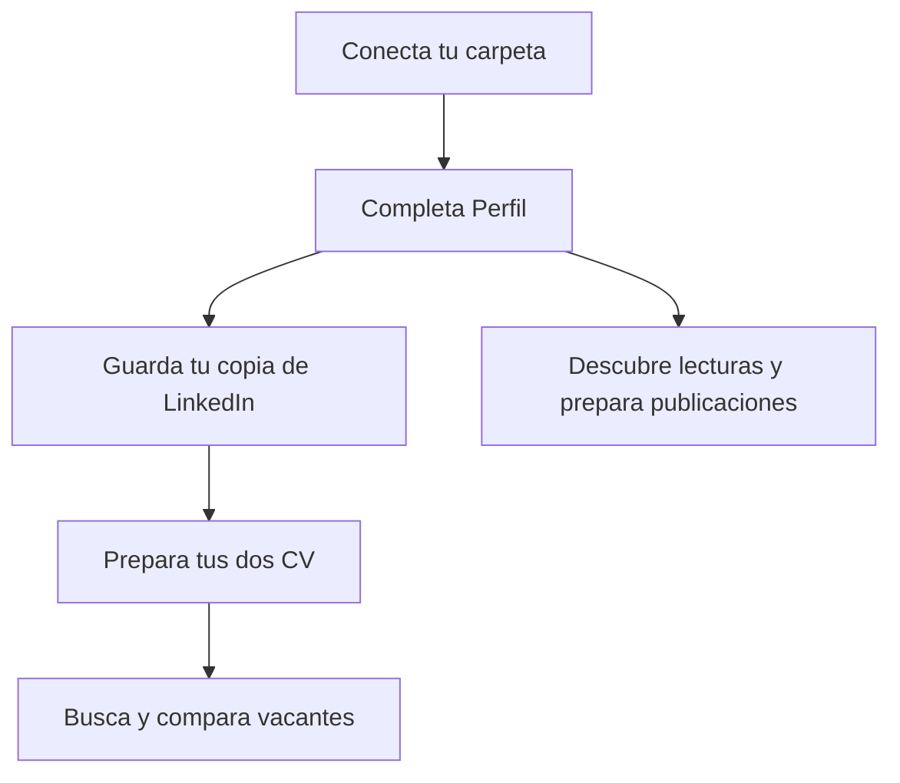

#  CareerKit

CareerKit reúne tu perfil profesional, aprendizajes, copia de LinkedIn, currículum y vacantes en una web que puedes usar en tu ordenador. Puedes rellenar los formularios a mano. Para tareas como buscar ofertas, revisar LinkedIn o preparar el CV, CareerKit te da instrucciones que puedes copiar a un asistente.

[Primera vez](#primera-vez) · [Abrirlo cada día](#volver-a-abrir-careerkit) · [Guía de pantallas](#qué-hay-en-cada-pantalla) · [Buzón](#buzón-cómo-usar-los-prompts) · [Si algo falla](#si-algo-falla) · [Datos y privacidad](#datos-y-privacidad) · [Publicación opcional](#publicación-opcional)

Un recorrido para empezar. Puedes usar cada sección cuando la necesites.



## Primera vez

1. En GitHub, abre el repositorio de CareerKit, pulsa **Code → Download ZIP** y descomprime el archivo. Si ya tienes la carpeta del proyecto, úsala directamente. Guárdala en un lugar donde puedas encontrarla después.
2. Abre **esa carpeta** como proyecto en un asistente de programación con acceso local, como Codex o Claude Code. Un chat que solo recibe texto no puede preparar archivos en tu ordenador.
3. Pega este mensaje en el chat del proyecto:

   > Prepara CareerKit en este ordenador. Lee AGENTS.md. Si falta Node.js o pnpm, guíame para instalarlos con pasos sencillos. Instala las dependencias con pnpm install --frozen-lockfile, prepara solo los archivos vacíos que falten con pnpm data:init y abre la web con pnpm local. Dame la dirección cuando esté lista. Si aparece la pantalla para conectar la carpeta, indícame cómo seleccionar private-data y conceder el permiso. Conserva los datos que ya existan y no publiques el proyecto.

4. Abre [CareerKit en tu ordenador](http://127.0.0.1:5173/). Si ya ves Inicio, puedes empezar. Si aparece **Conectar la carpeta de este proyecto**, puedes usarla para autorizar la carpeta que CareerKit ha encontrado. Para elegirla tú, pulsa **Conectar carpeta de datos**, selecciona **private-data** dentro del proyecto y acepta el permiso del navegador. Si te ofrece preparar archivos que faltan, confirma la creación de las plantillas vacías.

La primera apertura está vacía. Empieza por **Perfil y aprendizajes** y pulsa **Guardar** cuando hayas añadido información. Puedes dejar Vacantes vacía hasta que quieras buscar.

### Prepararlo sin asistente

Instala Node.js 24 y la versión de pnpm indicada en [package.json](package.json). Usa la aplicación **Terminal** de macOS o Linux o **Terminal de Windows**. Abre una terminal en la carpeta que contiene este README y `package.json`. En Windows, puedes abrir esa carpeta en el Explorador, escribir `powershell` en la barra de dirección y pulsar Intro. En macOS o Linux, abre Terminal, escribe `cd` seguido de un espacio, arrastra la carpeta a la ventana y pulsa Intro.

Ejecuta estos comandos de uno en uno, pulsando Intro después de cada línea:

```sh
pnpm install --frozen-lockfile
pnpm data:init
pnpm local
```

Cuando aparezca la dirección, abre [CareerKit](http://127.0.0.1:5173/). Los dos primeros comandos son de preparación. Si actualizas el proyecto y cambian sus dependencias, repite el primero. Puedes repetir el segundo para crear archivos que falten sin reemplazar los existentes.

## Volver a abrir CareerKit

**Para usar CareerKit cada día basta con abrir la carpeta del proyecto, iniciar la web y entrar en el navegador.** Puedes hacerlo sin abrir un asistente.

1. Abre una terminal en la carpeta de CareerKit.
2. Escribe **`pnpm local`** y pulsa Intro.
3. Abre [http://127.0.0.1:5173/](http://127.0.0.1:5173/) en tu navegador habitual. Guarda esta dirección en favoritos para encontrarla fácilmente.
4. Deja abierta la terminal mientras usas la web. Puedes minimizarla. Para detener CareerKit, vuelve a esa terminal y pulsa **Ctrl+C**.

Después de reiniciar el ordenador o detener CareerKit, repite estos pasos. Si la terminal sigue abierta con CareerKit en marcha, basta con abrir el favorito. La dirección funciona en el ordenador donde arrancaste la web.

### Abrirlo con doble clic

Si prefieres un icono en el Escritorio, pide al asistente que lo prepare **una sola vez**:

> Crea un acceso directo en mi Escritorio para abrir CareerKit con doble clic. Adáptalo a mi sistema y a la ubicación real de esta carpeta. Debe iniciar pnpm local en la carpeta de CareerKit, esperar a que responda http://127.0.0.1:5173/ y abrir esa dirección en mi navegador. Si CareerKit ya está abierto desde esta misma carpeta, reutiliza esa sesión. Si otra aplicación ocupa la dirección, muestra el error. Si falla el arranque, deja visible el mensaje de error. Dime cómo abrirlo y detenerlo. Guarda el acceso directo fuera del repositorio.

A partir de ahí usa el acceso directo. Si mueves la carpeta del proyecto, actualiza el acceso directo con su nueva ubicación.

## Qué hay en cada pantalla

| Pantalla | Acción que puedes hacer |
| --- | --- |
| [Inicio](#inicio) | Consulta qué falta y abre las vacantes destacadas. |
| [Perfil y aprendizajes](#perfil-y-aprendizajes) | Guarda tu trayectoria, intereses y preferencias. |
| [LinkedIn](#linkedin) | Conserva la copia publicada y revisa sugerencias. |
| [CV](#cv) | Consulta, imprime o guarda como PDF tus dos bases. |
| [Vacantes](#vacantes) | Busca, revisa, compara y prepara un CV por oferta. |
| [Contenido de LinkedIn](#contenido-de-linkedin) | Descubre lecturas y prepara publicaciones o comentarios. |
| [Tus publicaciones](#tus-publicaciones) | Revisa borradores y registra el texto que compartiste. |
| [Buzón](#buzón-cómo-usar-los-prompts) | Encuentra y copia instrucciones para tu asistente. |

### Inicio

Mira la guía de progreso para saber qué puedes preparar a continuación. Si faltan datos, sigue el enlace a Perfil, LinkedIn o CV. Las fechas de revisión y actualización aparecen como **Sin registrar** hasta que se guardan. Abre una vacante destacada para ver sus detalles. Si quieres que el asistente deje próximos pasos concretos en Inicio, copia **Añadir prioridades concretas a Inicio** desde el Buzón.

### Perfil y aprendizajes

1. Abre **Quién eres y cómo trabajas** para añadir motivaciones, valores, fortalezas y aspectos que quieras desarrollar. Este contexto es interno.
2. En el bloque de trabajo, indica puestos o tareas que te interesan, sectores, ubicación, modalidad, condiciones y qué prefieres evitar. Es lo que orienta la búsqueda de vacantes. Conserva también tus objetivos a corto, medio y largo plazo.
3. En **Intereses y voz para publicaciones**, añade temas, perspectivas, tono y preferencias de fuentes. Puedes anotar personas, medios o empresas que te gustaría seguir.
4. Añade formación, experiencia, habilidades, idiomas, certificaciones, proyectos y aprendizajes. En cada evidencia puedes indicar si está confirmada, sirve para el CV, aparece en LinkedIn o es interna. Añade acciones y resultados que puedas demostrar.
5. Pulsa **Guardar perfil**. Si prefieres ayuda, el Buzón ofrece tres entradas: una entrevista guiada, organizar el material que compartas y actualizar la trayectoria a partir de tu CV y LinkedIn. Comparte tus preferencias y objetivos directamente si quieres que el asistente los guarde.

### LinkedIn

1. Abre **Editar** para escribir lo que ya aparece en tu perfil. También puedes copiar **Rellenar LinkedIn desde un archivo** y adjuntar una copia legible o pegar el contenido en el chat. Expande las descripciones que estén cortadas. Si tienes el complemento de LinkedIn, el Buzón ofrece otro prompt para comprobar qué partes del perfil puede ver.
2. Guarda los cambios y abre **Vista previa** para comprobar el resultado. Elige **English** o **Español** para consultar cada versión. Usa **Actualizar las dos versiones de LinkedIn** en el Buzón cuando quieras que tu asistente revise las traducciones. El aviso se resuelve al detectar el estado guardado por el asistente.
3. Para pedir mejoras, copia **Auditar LinkedIn con Perfil y aprendizajes**. Recarga el archivo si aparece el aviso de cambio externo. En **Vista previa**, abre los marcadores que aparecen junto a las secciones auditadas, revisa la evidencia y decide si aplicas o descartas la propuesta. Pulsa **Guardar cambios de LinkedIn** para escribir el resultado en CareerKit.

La copia y sus auditorías viven en tu carpeta. Si decides trasladar cambios a tu perfil público, hazlo desde LinkedIn.

### CV

1. Guarda primero la información confirmada en **Perfil** y tu copia de **LinkedIn**. En **CV** o en el **Buzón**, copia **Actualizar la base general del CV**. Si ya tienes un CV que quieres usar como punto de partida, elige **Preparar las bases del CV desde un archivo** y adjúntalo.
2. Cuando el asistente confirme que guardó las versiones, abre **CV** y recarga el archivo si CareerKit lo pide. Selecciona **Español** para la base de dos columnas o **Inglés** para la base de una columna.
3. Pulsa **Imprimir o guardar PDF**. Elige una impresora o la opción de guardar como PDF de tu navegador. Cuando cambie tu trayectoria, vuelve a usar el prompt de actualización.
4. Para un CV dirigido a una empresa, entra en los detalles de la oferta y usa **Preparar CV para esta oferta**. El resultado se consulta allí.

### Vacantes

1. Completa tus preferencias en Perfil. En **Vacantes**, copia el prompt para buscar ofertas nuevas y pégalo en tu asistente. La búsqueda usa fuentes públicas, páginas de empleo y portales adecuados. Pide diez ofertas nuevas verificadas cuando sea posible y las ordena según tus preferencias. También puedes añadir una oferta manualmente, incluyendo el enlace y la fuente.
2. Abre **Ver detalles** para consultar el anuncio, salario, valoración y evidencias de encaje. Cuando se han podido verificar, aparecen el perfil oficial de la empresa, el contacto de selección y otros perfiles públicos de interés. Que una persona trabaje en selección no confirma que vaya a leer tu candidatura.
3. Selecciona hasta tres ofertas para compararlas. Puedes buscar y guardar más ofertas en tu lista. Si quieres comprobar si siguen abiertas, copia el prompt de **revisión de vigencia**. Las cerradas se conservan con su estado y enlace hasta que decidas eliminarlas.
4. Desde el detalle, abre **Preparar CV para esta oferta** y copia el prompt con esa vacante seleccionada. El asistente guarda las recomendaciones en sus detalles, indica qué base conviene y puede pedir aclaraciones. Cuando prepare y guarde el CV adaptado, lo verás en la misma oferta. En el Buzón también puedes pedir una valoración o una carta para una oferta concreta.

### Contenido de LinkedIn

Abre **Contenido de LinkedIn** para trabajar con lecturas, publicaciones y comentarios. El Buzón sigue disponible como catálogo de prompts.

1. En **Perfil → Intereses y voz para publicaciones**, indica temas que quieres explorar, voces profesionales y empresas u organizaciones que quieres seguir.
2. En **Contenido de LinkedIn → Artículos**, copia el prompt de búsqueda. El asistente consulta tus preferencias cuando tiene acceso local, busca en fuentes públicas como revistas, publicaciones especializadas, centros de investigación y LinkedIn, y comprueba las afiliaciones que cita.
3. Si el asistente guardó las lecturas, recarga `linkedin-content.json` cuando la web te avise. **Me interesa** y **Descartar** guardan la decisión al instante. Al volver a buscar, el asistente consulta las lecturas pendientes, aceptadas, publicadas y descartadas para no repetirlas; después limpia las fichas descartadas y conserva sus enlaces en una lista de exclusión.
4. En una lectura aceptada, escribe tu opinión. **Preparar publicación** la lleva al campo de opinión del flujo de publicaciones y la incluye en el prompt.
5. En **Contenido de LinkedIn → Publicaciones**, puedes preparar textos sobre logros o títulos, nuevos trabajos, ascensos, proyectos, experiencias o aprendizajes, opiniones y material que aportes. El prompt pide al asistente una versión completa **siempre en inglés** y, si tiene acceso local autorizado, la guarda en `drafts[]` de `linkedin-content.json`. Después ve a **Tus publicaciones → Borradores**. Si CareerKit avisa de un cambio externo, recarga el archivo para verla. Allí puedes editar el texto, guardar los cambios, dejarlo listo para publicar, registrarlo como publicado después de compartirlo realmente, o eliminarlo.
6. En **Comentarios**, pega la publicación y añade qué te gustaría aportar. Copia el prompt y revisa las propuestas en el chat. Puedes llevar a LinkedIn la que decidas usar.

### Tus publicaciones

- **Revisar un borrador.** Abre los borradores pendientes al principio de la pantalla. Puedes editar el texto en inglés, pulsar **Guardar edición**, confirmarlo como listo, copiarlo o eliminarlo. Si editas un texto confirmado, vuelve a quedar pendiente de revisión.
- **Registrar lo que compartiste.** Después de publicar en LinkedIn, registra el borrador como publicado o pega el texto final y pulsa **Guardar publicación publicada**. También puedes copiar el prompt **Registrar publicaciones ya publicadas** y enviar uno o varios textos finales al asistente. Si el registro está enlazado a una lectura aceptada, la lectura pasa a **Publicado**.
- **Consultar el archivo.** Las publicaciones registradas aparecen debajo, de más reciente a más antigua, seguidas de las que no tienen fecha en orden alfabético. Puedes editar o eliminar la copia local. Para modificar lo que ya compartiste en la red, abre LinkedIn.

## Buzón: cómo usar los prompts

Un **prompt** es un texto de instrucciones. Elige la tarea y, si te lo pide, selecciona una vacante. Pulsa **Copiar prompt** y pégalo en tu asistente. Añade el documento, texto o detalles que requiere la tarea. Si el asistente guardó cambios en tu carpeta, vuelve a la pantalla indicada y pulsa **Recargar** cuando CareerKit avise de que el archivo cambió. Copiar un prompt solo copia texto. Las tareas pendientes se resuelven al guardar el resultado correspondiente.

| Si quieres… | Busca en el Buzón… |
| --- | --- |
| Preparar o recuperar la carpeta | **Preparar o revisar los archivos de datos**. |
| Actualizar tu dossier o tu copia de LinkedIn | Las tres opciones de Perfil, la copia desde archivo o complemento, la auditoría y la revisión de los dos idiomas. |
| Preparar el CV o una candidatura | La base general o desde archivo, la búsqueda y revisión de vacantes, la valoración, la adaptación del CV y la carta. |
| Prepararte para una entrevista | **Convertir una experiencia en historia STAR** o **Elegir historias STAR para una vacante**. STAR organiza la situación, la tarea, la acción y el resultado. Puedes guardar una historia revisada como evidencia en Perfil. |
| Organizar próximos pasos | **Añadir prioridades concretas a Inicio**. |
| Crear contenido para LinkedIn | Descubrir artículos, redactar una publicación o comentario, registrar lo publicado, preparar un carrusel, reutilizar un texto, vídeo o podcast, pulir un borrador o preparar versiones en dos idiomas. |
| Revisar actividad en LinkedIn | Analizar métricas que compartas, preparar un plan de publicaciones, redactar notas de conexión y mensajes, clasificar mensajes que pegues o preparar respuestas a comentarios. |

### Cómo saber si se guardó

| Modo | Qué ocurre al guardar |
| --- | --- |
| **Carpeta de este proyecto** | CareerKit escribe en `private-data/` de la carpeta desde la que ejecutaste `pnpm local`. |
| **Carpeta seleccionada en el navegador** | CareerKit escribe directamente en esa carpeta con el permiso concedido. |
| **Archivos JSON individuales** | Pulsa **Guardar JSON individual** cuando la pantalla lo indique y sustituye el archivo de tu carpeta con el descargado. Al recargar la web, vuelve a abrir los JSON que necesites. |

En los dos modos de carpeta, espera a que la pantalla confirme el guardado y fíjate en el nombre del archivo. Si vas a editar también con el asistente, guarda primero el formulario y vuelve a cargarlo cuando aparezca un aviso de cambio externo.

## Si algo falla

| Qué ves | Qué hacer |
| --- | --- |
| El navegador dice que no se puede abrir la página | Ejecuta `pnpm local` en la carpeta de CareerKit y revisa el mensaje de la terminal. Si dice que el puerto 5173 está ocupado, comprueba si CareerKit ya está abierto o cierra la aplicación que lo ocupa. |
| La terminal dice que no encuentra `pnpm` o `package.json` | Si falta pnpm, instala el programa y vuelve a abrir la terminal. Si falta `package.json`, abre la terminal dentro de la carpeta descomprimida del proyecto. |
| La web vuelve a pedir acceso a la carpeta | Usa el navegador y la dirección habituales. Si te ofrece recuperar el permiso, acéptalo. Si cambiaste de navegador, de perfil o moviste la carpeta, selecciónala de nuevo. |
| La carpeta no se conecta dentro del navegador del asistente | Abre la dirección en tu navegador habitual. Prueba la selección de carpeta allí. Si el navegador ofrece **Abrir archivos JSON**, puedes seleccionar los archivos uno a uno. |
| El archivo está vacío, falta o necesita revisión | Una plantilla válida sin datos es normal. Si falta un archivo, usa la opción de preparar archivos o el prompt del Buzón. Si hay un aviso de formato, pídele al asistente que revise el archivo señalado y conserve su contenido. |
| El asistente guardó cambios y todavía ves datos anteriores | Espera al aviso de cambio externo y pulsa **Recargar**. Si abriste archivos individuales, vuelve a seleccionar la versión actual del archivo. |
| La web avisa de que el archivo cambió mientras editabas | Conserva tu borrador antes de recargar, usando la opción de copiarlo si aparece. Revisa la versión actual y vuelve a aplicar los cambios que quieras guardar. |

En el modo de archivos individuales, la web no detecta los cambios hechos en el disco mientras editas.

## Datos y privacidad

**La carpeta `private-data/` contiene tus datos.** Cada archivo JSON es un documento de texto estructurado. Puedes trabajar desde los formularios sin editarlo a mano.

| Archivo | Contenido |
| --- | --- |
| `profile.json` | Perfil, preferencias, objetivos y evidencias. |
| `linkedin.json` | Copia del perfil publicado, versiones por idioma y auditorías. |
| `cv.json` | Bases generales del CV y fechas. |
| `vacancies.json` | Ofertas, valoración y adaptaciones por vacante. |
| `priorities.json` | Prioridades que aparecen en Inicio. |
| `linkedin-content.json` | Cola de lecturas, borradores de publicaciones en inglés, enlaces para no repetir descartes y archivo del texto exacto de publicaciones que ya compartiste. |

En el modo local, CareerKit puede detectar la carpeta del proyecto y recuerda la conexión cuando el navegador lo permite. Tu selección manual tiene prioridad. Puedes usar **Desconectar carpeta** y, si quieres, confirmar que la web limpie los datos que tiene cargados. Los archivos del disco se conservan. Para cambiar de ordenador, copia la carpeta de datos por un medio que controles y conéctala en el nuevo equipo.

CareerKit no tiene cuenta, sincronización ni analítica. Si pegas un prompt con datos o adjuntas un documento en un chat externo, ese material lo recibe el servicio del chat. El acceso local del asistente depende de que pueda abrir la misma carpeta. Las plantillas vacías están en `templates/` y las reglas de cada archivo en `schemas/`. Para asistentes, consulta [AGENTS.md](AGENTS.md), el [formato local](schemas/agent-format.md) y el [índice de guías](.agents/skills/README.md).

## Publicación opcional

Puedes usar CareerKit siempre en tu ordenador. Si quieres publicar la web estática en GitHub Pages, abre el proyecto en el asistente y usa este prompt cuando tengas el destino decidido:

> Publica la web estática de CareerKit en GitHub Pages en este repositorio: [pega la dirección exacta]. Lee AGENTS.md. Confirma el destino y prepara la web con pnpm pages:prepare. Comprueba que la ruta de la web corresponde al nombre del repositorio. Revisa los archivos versionados y la carpeta dist para asegurarte de que no contienen datos personales ni private-data. Si aparece información personal o no puedes verificarlo, detente. Si todo está correcto, configura GitHub Pages, comprueba que el enlace abre y dime la dirección publicada.

La comprobación automática busca archivos privados y patrones conocidos. La revisión del contenido sigue siendo necesaria. En la versión publicada, cada persona conecta sus propios archivos desde su navegador.
